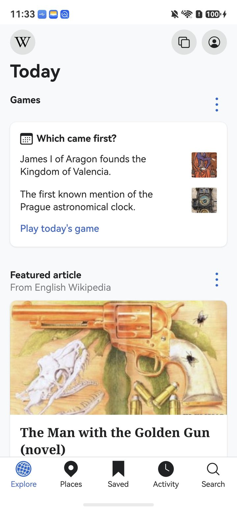
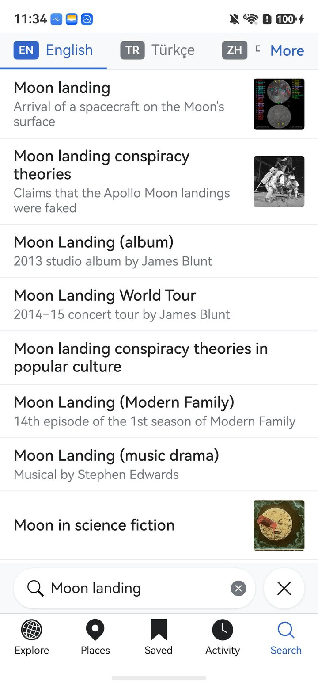
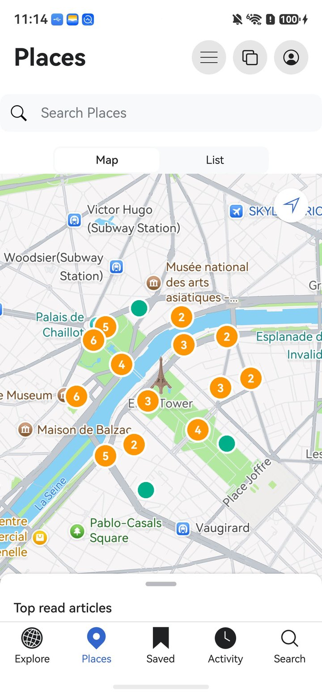

<p align="center"></p>
<h2 align="center"><b>Wikipedia</b></h2>
<h4 align="center">The free encyclopedia app for iOS, rebuilt natively for HarmonyOS.</h4>

<p align="center"></p>

> ### Please read this first
>
> This is an unofficial community port. It is not affiliated with, endorsed by, or supported by
> the Wikimedia Foundation or the Wikipedia iOS project. If something here is broken, it is
> broken here. Do not open an issue or a Phabricator task upstream for it.
>
> The name Wikipedia, the puzzle globe and the wordmark are trademarks of the Wikimedia
> Foundation. The MIT License covers the source code, not the name and not the artwork. Both are
> used here only to say what this is a port of, and both will change if the Wikimedia Foundation
> would rather we did not use them.

<p align="center"><a href="#screenshots">Screenshots</a> &bull; <a href="#install">Install</a> &bull; <a href="#known-limits">Known limits</a> &bull; <a href="#function-list-comparison">Function list comparison</a> &bull; <a href="#license">License</a></p>

<hr>

Wikipedia for iOS is the official Wikipedia reader for iPhone and iPad, written by the Wikimedia
Foundation and its volunteers. This repository is that app rewritten for HarmonyOS in ArkTS,
against ArkUI. It has the same Explore feed, article reader, search in every language, Places,
saved articles and reading lists with sync, history, editing, talk pages, notifications, the
Which Came First game and Year in Review, and it talks to the same Wikimedia APIs.

Upstream lives at [wikimedia/wikipedia-ios](https://github.com/wikimedia/wikipedia-ios).
This port is based on the Wikipedia for iOS release of 11 August 2026, build 6144 (upstream tag
[`releases/2026.08.11`](https://github.com/wikimedia/wikipedia-ios/tree/releases/2026.08.11)),
and reports the same version, `6144-r-2026-08-11`, on its About screen.
If you are on an iPhone, go there instead. This port exists for people whose phone runs HarmonyOS
and who want the same Wikipedia app on it.

## Screenshots

<p align="center">





</p>

Article text and images in these screenshots come from Wikipedia and Wikimedia Commons under
their own licenses (text: CC BY-SA 4.0). The Places map is Huawei Map Kit (Petal Maps).

## Install

There is no prebuilt package here. You build it and sign it yourself, which also means the package
carries your certificate and your device list rather than someone else's.

You need DevEco Studio 6.x with the HarmonyOS SDK 6.1.1 (API 24), a Huawei developer account,
and a phone running HarmonyOS.

1. Clone this repository and open the folder in DevEco Studio.
2. Go to **File > Project Structure > Signing Configs**. Sign in, connect the device, and let
   DevEco generate a signature. The bundle name is `com.etspworks.Wikipedia.hmos`. Click
   **Enable open capabilities**, select **Map Kit** and apply: the Places map is Huawei Map Kit
   and stays blank in a build signed without it.
3. Build it: **Build > Build Hap(s)/APP(s) > Build Hap(s)**. The package lands in
   `entry/build/default/outputs/default/`.
4. Install and launch it:

```bash
hdc install -r entry-default-signed.hap
hdc shell aa start -a EntryAbility -b com.etspworks.Wikipedia.hmos
```

A generated debug signature only installs on the devices registered to it, and it expires. When it
does, open the same dialog and generate it again.

## Known limits

- The Places map needs Map Kit enabled in the signing profile (step 2 of Install). Without it,
  Places shows the article pins on a blank map; the List view works either way.
- No push notifications. Push Kit is not connected, so nothing arrives while the app is closed.
  The notifications screen still loads your Wikipedia notifications when you open it.
- Donating opens the Wikimedia donation web page. Apple Pay does not exist on HarmonyOS.
- Phones only. There is no tablet or watch layout.

## Function List Comparison

| Module | Rows | Both | iOS | HarmonyOS |
|---|---:|---:|---:|---:|
| Welcome | 11 | 10 (91%) | 0 | 1 |
| App Onboarding | 9 | 0 (0%) | 9 | 0 |
| Explore | 70 | 42 (60%) | 17 | 11 |
| Which Came First | 26 | 16 (62%) | 9 | 1 |
| Image Recommendations | 11 | 0 (0%) | 11 | 0 |
| Home | 23 | 1 (4%) | 22 | 0 |
| Article | 177 | 87 (49%) | 75 | 15 |
| Editor | 138 | 7 (5%) | 131 | 0 |
| Talk Page | 50 | 17 (34%) | 31 | 2 |
| Page History | 32 | 9 (28%) | 21 | 2 |
| Search | 43 | 25 (58%) | 14 | 4 |
| Places | 35 | 18 (51%) | 3 | 14 |
| Saved | 67 | 35 (52%) | 24 | 8 |
| Activity | 48 | 25 (52%) | 20 | 3 |
| Tabs | 18 | 10 (56%) | 7 | 1 |
| App Shell | 49 | 17 (35%) | 32 | 0 |
| Profile | 28 | 27 (96%) | 0 | 1 |
| Log In | 36 | 23 (64%) | 7 | 6 |
| Notifications Center | 33 | 9 (27%) | 21 | 3 |
| Watchlist | 15 | 14 (93%) | 1 | 0 |
| Donate | 23 | 7 (30%) | 16 | 0 |
| Settings | 142 | 78 (55%) | 45 | 19 |
| Temporary Account | 11 | 10 (91%) | 1 | 0 |
| Widgets | 14 | 0 (0%) | 14 | 0 |
| Global | 13 | 3 (23%) | 6 | 4 |
| **Total** | **1122** | **490 (44%)** | **537** | **95** |

The iOS list has 1027 functions and this port's list has 600. Most iOS-only rows sit in a few
places: the source editor's tools (131 of the 138 Editor rows; here the editor is a plain
wikitext field with an edit summary and Publish), developer and experiment screens, the
experimental Home tab, the native donation form (donating opens the Wikimedia web page here), and
the widgets and quick actions outside the app. Most HarmonyOS-only rows are buttons the iOS list
does not count as functions of their own: close and cancel buttons, the tab bar repeated on each
screen, Places map interactions, and the About screen's links, which are a web page on iOS.
The full table, one row per function with a note wherever the two apps differ, is in
[docs/FUNCTION_LIST_COMPARISON.md](docs/FUNCTION_LIST_COMPARISON.md).

## License

MIT, the same as upstream. `LICENSE` is the upstream file, unchanged:

```
Copyright (c) 2013–2025 Wikimedia Foundation et al.
```

Everything written for HarmonyOS is released under those same terms. `NOTICE` lists what came over
from upstream, the license of the Noto Serif font that ships inside the app (SIL Open Font
License), and the licenses of the content the app loads at run time.

More about the Wikipedia apps: [mediawiki.org/wiki/Wikimedia_Apps](https://www.mediawiki.org/wiki/Wikimedia_Apps)
